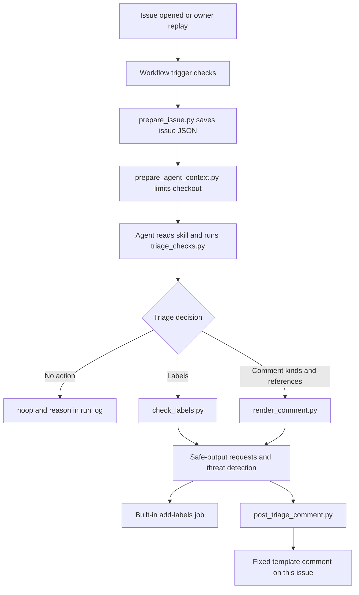

# How the codebase works

This repository configures an existing agent for one task: read a newly opened Electron
issue and suggest first-pass triage. It does not contain Electron's source or build Electron.
Python handles deterministic checks, data preparation and evaluation; the model decides what
the report means. GitHub Actions controls which decisions can become repository writes.

## Follow one issue

1. `.github/workflows/issue-triage.md` defines the triggers, limits and permitted outputs.
   `gh aw compile` turns it into `issue-triage.lock.yml`, the file GitHub Actions executes.
   Outside contributors can trigger triage; maintainer-authored live events are skipped.
   Replays use `workflow_dispatch` with the historical opening time and author association.
2. `prepare_issue.py` fetches the run's issue with a read-only token and writes
   `.triage/issue.json`. It validates the issue number and rejects pull requests. The replay
   overrides come from workflow inputs that issue authors cannot set.
3. `prepare_agent_context.py` filters the corpus on disk to rows before `as_of` and removes
   evaluation files and outcome-bearing prose from the disposable Actions checkout. Its
   command-line entry point refuses ordinary local execution. Git history remains, so this
   reduces exposed context without creating complete filesystem or network isolation.
4. The agent loads `.claude/skills/issue-triage/SKILL.md`. `triage_checks.py` returns a JSON
   report: whether to skip, form fields, reproduction evidence, component hints, redirect
   hints and similar earlier issues. The model assesses the text before proposing an action.
5. The skill calls `check_labels.py` for proposed labels and `render_comment.py` for proposed
   comment kinds. A kind is a fixed category such as `need-repro`, `similar` or `security`.
   The model supplies categories and reference numbers; template code supplies the wording.
6. GitHub Agentic Workflows collects the safe-output requests and runs threat detection. If
   the `triage-writes` environment has a required reviewer, the run waits for approval at its
   start, before its write jobs and at its conclusion; by default it has none.
   The built-in label job permits one call with at most three existing allowed labels on the
   run's issue. The separate comment job has `issues: write`; the agent itself has read-only
   repository permissions. `post_triage_comment.py` requires a successful detection verdict,
   validates the request through the renderer, and posts at most one template comment to the
   issue supplied by workflow context. `noop` records a reason and makes no issue write.

The workflow also disables gh-aw's automatic issue creation for failure, incomplete, missing-tool
and missing-data reports. `safe-outputs.threat-detection.report-as-issue: false` disables the
detector's separate tracking-issue channel while leaving threat detection enabled. The
missing-tool and missing-data flags explicitly limit reporting behavior; they are not evidence
that an attacker used those channels in a recorded run.

The configured shell commands are the three skill scripts; the compiler adds 13 read-only
commands (`cat`, `grep`, …). Historical logs also show default
agent file-reading tools; a shell allowlist is not a statement that the agent has no other
read access. Issue text, retrieved excerpts and tool responses remain untrusted. Allowed
labels and templates limit what can be posted, but a permitted suggestion can still be wrong.

The eight-minute timeout and 100-credit cap in the source apply to the agent step. Detection
and other jobs have their own limits in the compiled workflow. Session costs in the evaluation
are agent-only costs; do not present them as total workflow spending.

## Runtime scripts

| Script | Input | Output and side effects |
|---|---|---|
| `scripts/prepare_issue.py` | Workflow environment and GitHub issue API | Writes `.triage/issue.json`; reads GitHub, makes no issue write |
| `scripts/prepare_agent_context.py` | `.triage/issue.json` and the Actions checkout | Filters `data/issue-corpus.jsonl` and removes evaluation/prose files in that disposable checkout |
| `.claude/skills/issue-triage/scripts/triage_checks.py` | Issue JSON, component keywords and corpus | Prints evidence and ranked candidates; no network or issue writes |
| `.claude/skills/issue-triage/scripts/check_labels.py` | Proposed label arguments and the allowlist | Prints validation results and returns failure for rejected labels |
| `.claude/skills/issue-triage/scripts/render_comment.py` | `--kinds`, optional `--refs`, corpus | Prints a fixed comment or rejects invalid combinations/references; no posting |
| `scripts/post_triage_comment.py` | Agent-output JSON, detection verdict and workflow target | Validates the first requested comment and posts it through `gh api` if accepted |

`triage_checks.py` uses BM25, a word-based relevance score, to retrieve five candidate issues.
It weights title terms more heavily and removes issue-form boilerplate before matching.
Sharing terms does not establish that two reports describe the same bug; the skill requires
matching symptoms. The component table is also a hint table, not a label decision.

The renderer rejects unknown comment kinds, a security redirect combined with other kinds,
and references absent from the corpus or pointing to the synthetic attack row. The poster
renders again outside the model's environment, so the posted text does not depend on the
model copying the template faithfully. Its fresh checkout contains the full corpus, but it
independently checks each reference against a trusted opening-time cutoff before posting.
For replays, that cutoff is the workflow's `AS_OF` input; otherwise it fetches the target
issue's opening time. The model cannot supply a different cutoff in its output request.

## Evaluation and analysis scripts

All paths below start at the repository root. A tool described as offline can still overwrite
local reports. Use the disposable-copy recipe in [the evaluation guide](../evals/golden/README.md).

| Script | Purpose and side effects |
|---|---|
| `evals/tools/fetch_issues.py` | Reads Electron's GitHub history and writes raw API pages plus opening-state rows in `evals/data/`; needs authenticated `gh` |
| `evals/tools/build_cases.py` | Rebuilds real-case `input.json` files from those rows; historical setup utility that must not be run over the frozen cases |
| `evals/tools/drift_report.py` | Compares `results/score-<runs>.json` with a reference run set; writes `results/drift-<runs>.md` and prints whether owner review is needed |
| `evals/tools/replay.py` | `labels` creates sandbox labels; `file` creates neutralised sandbox issues; `dispatch` starts workflows at an optional `--ref`; `collect` saves successful outputs and separates unsuccessful executions; `--variant` selects the evidence namespace |
| `evals/tools/baseline.py` | Runs fixed rules over the deterministic report and writes one local output per case; `--out` selects a new destination |
| `evals/tools/score.py` | Frozen scorer: reads expected and actual outputs, writes `results/score-<runs>.json`, and reports pass rates, error costs and safety failures |
| `evals/tools/requested_view.py` | Copies a run set into `<runs>-requested/` with the labels the agent requested, so the frozen scorer can score decisions apart from label delivery |
| `evals/tools/skill_check.py` | Reads each run's inventory/session evidence, checks skill use and validation order, and writes `results/skill-check-<runs>.json` with costs and tools |
| `evals/tools/stats.py` | Reads score reports, checks planned-run coverage and reports case-level statistics; keeps incomplete evidence from becoming a full acceptance claim |
| `evals/tools/agreement.py` | Compares frozen expectations with maintainers' later actions; optionally extracts those actions from saved raw data and writes the agreement report |
| `evals/need/analyze_issues.py` | Reads saved Q3 issue histories and opening-state records; writes `issues_table.csv` and `issue_metrics.json` |
| `evals/need/analyze_extra.py` | Reads those histories and the issue table; writes `extra_metrics.json` for reproduction requests, an AI-authorship proxy and duplicate-link delay |
| Other archives | The reproduction check, the coding-assistant dry run and raw recheck logs are on [`archive/full-evidence`](https://github.com/ceewaigit/cs467-electron-triage/tree/archive/full-evidence) |
| Archived experiments | `conservative-linking`, `judgment-check` and `failure-recheck-offline` (with the two failed live attempts) are on the [`archive/experiments` branch](https://github.com/ceewaigit/cs467-electron-triage/tree/archive/experiments/evals) |

`evals/controls/broken_config.sh` is the only shell helper. It changes temporary workflow
copies to check that broad permissions and forbidden outputs fail compilation or configuration
tests. The obeying and forced-actions workflows in the same directory are inert records of control
experiments, described in the evaluation guide.

## Tests and configuration files

| File | What it checks or controls |
|---|---|
| `tests/test_skill_scripts.py` | Deterministic triage checks, labels, templates, workflow restrictions and mocked posting |
| `tests/test_agent_context.py` | Corpus cutoffs, removal of grading material and refusal of unsafe local cleanup |
| `tests/test_comment_templates.py` | Security-only comments and exclusion of the synthetic reference |
| `tests/test_post_triage_comment.py` | Successful detection required before posting, and references must precede the trusted opening-time cutoff |
| `tests/test_evaluation_stats.py` | Incomplete experiments cannot be reported as meeting the full evaluation protocol |
| `tests/test_need_analysis.py` | Opening-time form and gist measurements, including edited-body cases |
| `tests/test_skill_evidence.py` | Versioned script markers count as evidence without inventing a successful check |
| `tests/test_replay_collection.py` | Successful no-action runs remain scorable; failures stay separate; forced refresh preserves evidence categories; dispatch filters refs and rejects ambiguous matches |
| `tests/test_requested_view.py` | The requested-label view reads both label forms and leaves comments unchanged |
| `.github/workflows/checks.yml` | Runs offline checks and the deterministic baseline in CI with a read-only token, and fails if a compiled lock differs from its source |
| `.github/workflows/issue-triage-codex.md` and `.lock.yml` | Manual fallback on the Codex engine, also used for the 90-run evaluation; dispatch only, and its shell is open because Codex cannot restrict commands |
| `.github/workflows/drift-check.yml` | Replays all 30 cases once, scores them, runs `drift_report.py` against a reference run set and opens a `drift-review` issue when anything changed; dispatch, or weekly while `DRIFT_WEEKLY` is `true` |
| `.github/aw/actions-lock.json` | Action-version resolution used by the workflow compiler |
| `.github/CODEOWNERS` | Requests owner review for protected areas; required review also needs repository settings |
| `AGENTS.md` and `CONTRIBUTING.md` | Repository editing rules and contributor AI policy |
| `docs/DRIFT_REVIEW.md` | The drift check, the owner's review of its issues, and the weekly schedule |

Read the relevant test beside the implementation. Mocked `gh` calls show what the script
would request, without contacting GitHub. Compilation and source checks inspect configuration;
only a recorded live run can establish what happened in GitHub Actions for that version.

## Follow the evidence

`evals/data/` holds reconstructed opening states. The frozen golden `input.json` files select
from those records; `expected.json` files state the desired outcomes. The runtime corpus in
`data/` gives the model earlier issues to compare. `evals/need/raw/` contains later activity
used to measure triage delays, which must stay outside the agent's context.

For a live replay, `evals/golden/replay/issues-<variant>.json` maps cases to neutralised sandbox
issues; `runs-<variant>.json` in the same directory maps them to workflow runs. `--variant`
selects those filenames, while `--ref` selects the branch or tag to run. Dispatch records and
collected outcomes preserve the requested ref and GitHub's actual commit SHA and branch.
Run association requires one dispatcher and no concurrent manual triggers for that workflow.
The helper rejects multiple new runs on the expected branch, but run-list metadata lacks the
issue-number input, so a single competing run on that branch can still be misassociated.
The collector reads the resulting issue timeline and saves actions from successful
executions in `evals/golden/cases/<id>/actual/<variant>/run-N.json`. The
sibling `logs/run-N/` directory holds the prompt and execution evidence. Unsuccessful runs
go into `failures/run-N.json` with `scored: false`, their exclusion reason and any partial
actions; their logs go into `failures/logs/run-N/`. The scorer reads only top-level outputs,
and the skill checker reads their corresponding logs. Inspect the failure records too before
making a correctness, coverage or control claim.

Collection normally preserves existing records. `--force` can refresh a record within its
existing success or failure category; it refuses a category change before touching the JSON
or logs. A changed outcome needs fresh sandbox issues and a separate experiment namespace.

The stored `agent`, `agent-v2`, `final`, `obey`, `codex`, `baseline` and `baseline-v2` variants
represent different experiments. `final` contains 79 of the planned 90 outputs; eleven executions failed
because provider credit ran out and are documented separately.

The live recheck at `1173463` and the 90 `codex` runs (`results/codex.md`) exercise the runtime
before three small fixes (renderer v4 trailer, `component/other`, missing-output check); none
of them would change a recorded output.

## Explain the submission

Each question below can be answered from a file or a recorded run:

- Why does the task need model judgement, and which decisions can fixed rules handle?
- Which token can write, which outputs can it perform, and how is the issue target chosen?
- Why does an instruction claiming maintainer approval inside an issue grant no extra power?
- What do a correct skip, a failed execution and a missing output look like in the evidence?
- How were expected outcomes fixed, and where can hindsight still affect the evaluation?
- Why do repeated-run pass rates differ from pass^3, and which denominators exclude missing runs?
- Which controls were exercised live, which were tested offline, and which remain proposals?
- How would the owner detect drift, stop new runs and cancel a running workflow from a phone?
- Which work used AI, and how was it verified?
