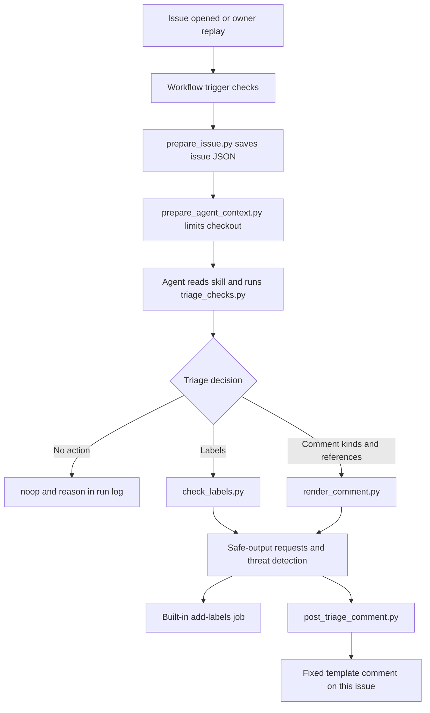

# How the codebase works

Python does the checks that need no judgement, the model decides what a report means, and GitHub
Actions controls which decisions can become writes. There is no Electron source here.

## Follow one issue

1. **Trigger.** `issue-triage.md` compiles to `issue-triage.lock.yml`, which Actions runs. Outside
   contributors trigger it; maintainers' own issues are skipped. Replays use `workflow_dispatch`
   with the original opening time and author association, inputs issue authors cannot set.
2. **Prepare.** `prepare_issue.py` saves the issue to `.triage/issue.json` and rejects pull requests.
   `prepare_agent_context.py` cuts the corpus to earlier issues and removes evaluation files from
   the checkout. Git history remains, so this reduces what the agent can see but is not isolation.
3. **Decide.** The agent loads the skill. `triage_checks.py` reports skip reasons, form fields, repro
   evidence, hints and similar issues. The model chooses labels, comment kinds and issue numbers.
4. **Check.** `check_labels.py` validates labels. `render_comment.py` turns kinds into fixed text.
5. **Write.** gh-aw runs threat detection. The label job allows one call with up to three allowed
   labels on this issue. `post_triage_comment.py` needs a `success` verdict, renders the comment
   again outside the model's environment and posts one. `noop` records a reason and writes nothing.

**What limits it.** The agent token is read-only. The shell runs the three skill scripts and 13
read-only commands. Allowed labels and templates limit what can be posted, but a permitted
suggestion can still be wrong. gh-aw's automatic failure issues are off.

**Costs.** The 8-minute and 100-credit limits apply to the agent step; detection has its own. Session
costs are agent-only, so do not quote them as the total.

## Runtime scripts

| Script | What it does |
|---|---|
| `scripts/prepare_issue.py` | Saves the issue; reads GitHub, writes nothing to it |
| `scripts/prepare_agent_context.py` | Filters the corpus and removes evaluation files; refuses to run locally |
| `.claude/skills/issue-triage/scripts/triage_checks.py` | Prints evidence and five BM25 candidates; title words weigh more |
| `.claude/skills/issue-triage/scripts/check_labels.py` | Checks labels against the allowlist |
| `.claude/skills/issue-triage/scripts/render_comment.py` | Renders templates; rejects unknown kinds, security mixed with others, and references outside the corpus or to row `900001` |
| `scripts/post_triage_comment.py` | Validates the request, checks references against a trusted opening time the model cannot set, and posts |

## Evaluation scripts

These can overwrite local reports, so run them in a [copy](../evals/golden/README.md#reproduce-the-analysis-offline).

| Script | What it does |
|---|---|
| `evals/tools/fetch_issues.py` | Saves Electron issue history to `evals/data/`; needs `gh` |
| `evals/tools/build_cases.py` | Built the real `input.json` files; never run it over the frozen cases |
| `evals/tools/replay.py` | `labels`, `file`, `dispatch`, `collect`; `--variant` names the run set, `--ref` the branch |
| `evals/tools/score.py` | Frozen scorer: pass rates, error cost, safety failures |
| `evals/tools/baseline.py` | Rule baseline; `--out` writes under a new name |
| `evals/tools/requested_view.py` | Copies a run set with requested labels, to score decisions apart from delivery |
| `evals/tools/skill_check.py` | Checks skill use and validation order; reports costs and tools |
| `evals/tools/stats.py` | Case-level statistics; stops incomplete runs being reported as complete |
| `evals/tools/drift_report.py` | Compares a run set with a reference; says if review is needed |
| `evals/tools/agreement.py` | Compares expected outcomes with what maintainers later did |
| `evals/need/analyze_issues.py`, `analyze_extra.py` | Q3 need metrics from saved issue histories |
| `evals/controls/broken_config.sh` | Checks that broad permissions and forbidden outputs fail on temporary workflow copies |

The obey and forced workflows in `evals/controls/` are inert records.

## Tests and configuration

| File | Covers |
|---|---|
| `tests/test_skill_scripts.py` | Checks, labels, templates, workflow restrictions, mocked posting |
| `tests/test_agent_context.py` | Corpus cutoffs and removal of grading material |
| `tests/test_comment_templates.py` | Security-only comments; the synthetic reference |
| `tests/test_post_triage_comment.py` | Needs `success`; references must precede the trusted cutoff |
| `tests/test_evaluation_stats.py` | Incomplete runs cannot pass as complete |
| `tests/test_need_analysis.py` | Opening-time form and gist measures |
| `tests/test_skill_evidence.py` | Script markers count as evidence only on a real success |
| `tests/test_replay_collection.py` | No-action runs stay scored; failures stay separate; ambiguous dispatches stop |
| `tests/test_requested_view.py` | The requested-label view |
| `.github/workflows/checks.yml` | Runs tests and the baseline; fails on a stale lock |
| `.github/workflows/issue-triage-codex.md` | Manual Codex fallback, used for the final evaluation; dispatch only because its shell is open |
| `.github/workflows/drift-check.yml` | See [DRIFT_REVIEW.md](DRIFT_REVIEW.md) |
| `.github/aw/actions-lock.json` | Action versions for the compiler |
| `.github/CODEOWNERS` | Owner review; enforcement needs the ruleset |

Mocked tests show what a script would request. Only a recorded live run shows what happened.

## Follow the evidence

- `evals/data/` holds opening states; `input.json` selects from them; `expected.json` states outcomes.
- `evals/golden/replay/issues-<variant>.json` and `runs-<variant>.json` map cases to issues and runs.
- `cases/<id>/actual/<variant>/run-N.json` and `logs/run-N/` hold what happened in successful runs.
- `failures/` holds unsuccessful runs. The scorer skips them, so check them before making a claim.
- `collect --force` refreshes a record only within its category. A changed outcome needs fresh issues
  and a new variant name.

## Be ready to explain

- Why does this need a model, and what can fixed rules handle?
- Which token can write, what can it do, and how is the issue chosen?
- Why does "a maintainer approved this" inside an issue grant nothing?
- What do a correct skip, a failed run and a missing output look like?
- How were expected outcomes fixed, and where can hindsight still get in?
- Which controls ran live, which offline, and which are only proposed?
- How would the owner detect drift, and stop a run from a phone?
- Which work used AI, and how was it verified?
