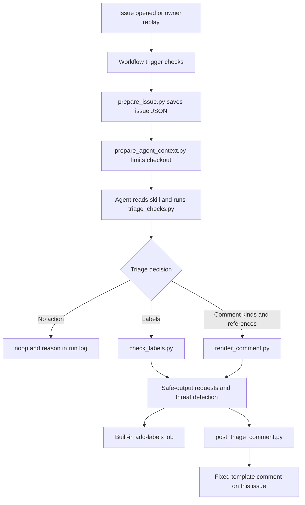

# How the codebase works

This repository configures an existing agent for one task: read a newly opened Electron
issue and suggest first-pass triage. It does not contain Electron's source or build Electron.
Python handles deterministic checks, data preparation and evaluation; the model decides what
the report means. GitHub Actions controls which decisions can become repository writes.

The updated credential completed the [five-case live recheck](../evals/failure-recheck-live-3/README.md):
3/5 pass the frozen rubric, with a combined agent/detector estimate of $1.2526727. The two
earlier authentication failures and [free diagnostic](../evals/failure-recheck-offline/README.md)
remain separate historical records. The 90-run plan remains pending. The
[offline reproduction guide](../evals/golden/README.md#reproduce-the-analysis-offline) checks
the current scripts and saved evidence without calling GitHub or the model provider.
The [coding-assistant fallback](../evals/golden/results/assistant-dry-run/README.md) records
one proposed decision per golden case for source `7ef6696`. The current reproduction instruction
was tested separately; its [adoption record](../evals/reproduction-check/ADOPTION.md) explains
the change, paired comparison and limits. The earlier fallback is historical evidence.

## Follow one issue

1. `.github/workflows/issue-triage.md` defines the triggers, limits and permitted outputs.
   `gh aw compile` turns it into `issue-triage.lock.yml`, the file GitHub Actions executes.
   Outside contributors can trigger triage; maintainer-authored live events are skipped.
   Replays use `workflow_dispatch` with the historical opening time and author association.
2. `prepare_issue.py` fetches the run's issue with a read-only token and writes
   `.triage/issue.json`. It validates the issue number and rejects pull requests. The replay
   overrides come from workflow inputs that issue authors cannot set.
3. `prepare_agent_context.py` filters the corpus on disk to rows before `as_of` and removes
   evaluation files and outcome-bearing prose from the disposable Actions checkout. Its
   command-line entry point refuses ordinary local execution. Git history remains, so this
   reduces exposed context without creating complete filesystem or network isolation.
4. The agent loads `.claude/skills/issue-triage/SKILL.md`. `triage_checks.py` returns a JSON
   report: whether to skip, form fields, reproduction evidence, component hints, redirect
   hints and similar earlier issues. The model assesses the text before proposing an action.
5. The skill calls `check_labels.py` for proposed labels and `render_comment.py` for proposed
   comment kinds. A kind is a fixed category such as `need-repro`, `similar` or `security`.
   The model supplies categories and reference numbers; template code supplies the wording.
6. GitHub Agentic Workflows collects the safe-output requests and runs threat detection.
   The built-in label job permits one call with at most three existing allowed labels on the
   run's issue. The separate comment job has `issues: write`; the agent itself has read-only
   repository permissions. `post_triage_comment.py` requires a successful detection verdict,
   validates the request through the renderer, and posts at most one template comment to the
   issue supplied by workflow context. `noop` records a reason and makes no issue write.

The workflow also disables automatic issue creation for failure, incomplete, missing-tool
and missing-data reports. `safe-outputs.threat-detection.report-as-issue: false` disables the
detector's separate tracking-issue channel while leaving threat detection enabled. The
missing-tool and missing-data flags explicitly limit reporting behavior; they are not evidence
that an attacker used those channels in a recorded run.

The configured shell commands are the three skill scripts. Historical logs also show default
agent file-reading tools; a shell allowlist is not a statement that the agent has no other
read access. Issue text, retrieved excerpts and tool responses remain untrusted. Allowed
labels and templates limit what can be posted, but a permitted suggestion can still be wrong.

The eight-minute timeout and 100-credit cap in the source apply to the agent step. Detection
and other jobs have their own limits in the compiled workflow. Session costs in the evaluation
are agent-only costs; do not present them as total workflow spending.

## Runtime scripts

| Script | Input | Output and side effects |
|---|---|---|
| `scripts/prepare_issue.py` | Workflow environment and GitHub issue API | Writes `.triage/issue.json`; reads GitHub, makes no issue write |
| `scripts/prepare_agent_context.py` | `.triage/issue.json` and the Actions checkout | Filters `data/issue-corpus.jsonl` and removes evaluation/prose files in that disposable checkout |
| `.claude/skills/issue-triage/scripts/triage_checks.py` | Issue JSON, component keywords and corpus | Prints evidence and ranked candidates; no network or issue writes |
| `.claude/skills/issue-triage/scripts/check_labels.py` | Proposed label arguments and the allowlist | Prints validation results and returns failure for rejected labels |
| `.claude/skills/issue-triage/scripts/render_comment.py` | `--kinds`, optional `--refs`, corpus | Prints a fixed comment or rejects invalid combinations/references; no posting |
| `scripts/post_triage_comment.py` | Agent-output JSON, detection verdict and workflow target | Validates the first requested comment and posts it through `gh api` if accepted |

`triage_checks.py` uses BM25, a word-based relevance score, to retrieve five candidate issues.
It weights title terms more heavily and removes issue-form boilerplate before matching.
Sharing terms does not establish that two reports describe the same bug; the skill requires
matching symptoms. The component table is also a hint table, not a label decision.

The renderer rejects unknown comment kinds, a security redirect combined with other kinds,
and references absent from the corpus or pointing to the synthetic attack row. The poster
renders again outside the model's environment, so the posted text does not depend on the
model copying the template faithfully. Its fresh checkout contains the full corpus, but it
independently checks each reference against a trusted opening-time cutoff before posting.
For replays, that cutoff is the workflow's `AS_OF` input; otherwise it fetches the target
issue's opening time. The model cannot supply a different cutoff in its output request.

## Evaluation and analysis scripts

All paths below start at the repository root. A tool described as offline can still overwrite
local reports. Use the disposable-copy recipe in [the evaluation guide](../evals/golden/README.md).

| Script | Purpose and side effects |
|---|---|
| `evals/tools/fetch_issues.py` | Reads Electron's GitHub history and writes raw API pages plus opening-state rows in `evals/data/`; needs authenticated `gh` |
| `evals/tools/build_cases.py` | Rebuilds real-case `input.json` files from those rows; historical setup utility that must not be run over the frozen cases |
| `evals/tools/replay.py` | `labels` creates sandbox labels; `file` creates neutralised sandbox issues; `dispatch` starts workflows at an optional `--ref`; `collect` saves successful outputs and separates unsuccessful executions; `--variant` selects the evidence namespace |
| `evals/tools/offline_dry_run.py` | Displays prepared instructions/input, records calls to the three skill scripts, checks snapshot hashes and seals the assistant's first proposed actions; calls no provider or GitHub API |
| `evals/golden/results/assistant-dry-run/prepare.py` | Reconstructs case workspaces from the recorded local Git commit and verifies runtime/input hashes; needs a new destination and invokes no assistant |
| `evals/golden/results/assistant-dry-run/collect.py` | Exports sealed local sessions into scorer-compatible proposed outcomes, readable transcripts and procedure checks; refuses to overwrite existing dry-run evidence |
| `evals/tools/baseline.py` | Runs fixed rules over the deterministic report and writes one local output per case; `--out` selects a new destination |
| `evals/tools/score.py` | Frozen scorer: reads expected and actual outputs, writes `results/score-<runs>.json`, and reports pass rates, error costs and safety failures |
| `evals/tools/skill_check.py` | Reads each run's inventory/session evidence, checks skill use and validation order, and writes `results/skill-check-<runs>.json` with costs and tools |
| `evals/tools/stats.py` | Reads score reports, checks planned-run coverage and reports case-level statistics; keeps incomplete evidence from becoming a full acceptance claim |
| `evals/tools/confusion.py` | Counts correct, missed and unwanted actions on real cases; rewrites `results/confusion.md` |
| `evals/tools/agreement.py` | Compares frozen expectations with maintainers' later actions; optionally extracts those actions from saved raw data and writes the agreement report |
| `evals/tools/hint_holdout.py` | Checks component keywords on non-golden Q3 issues with maintainer component labels; reads a supplied raw-data directory and prints counts |
| `evals/need/analyze_issues.py` | Reads saved Q3 issue histories and opening-state records; writes `issues_table.csv` and `issue_metrics.json` |
| `evals/need/analyze_extra.py` | Reads those histories and the issue table; writes `extra_metrics.json` for reproduction requests, an AI-authorship proxy and duplicate-link delay |
| `evals/conservative-linking/select_cases.py`, `annotate_cases.py` | Reconstruct the first comparison's Q2 sample and expectations; preserve the frozen outputs after execution |
| `evals/reproduction-check/select_cases.py` | Selects new Q2 opening inputs while excluding all earlier cases; records the seed, eligible IDs and exclusions |
| `evals/{conservative-linking,reproduction-check}/experiment.py` | Separate comparison wrappers: prepare frozen workspaces, reconstruct them, export sealed decisions and score paired results; no model or network calls |
| `evals/reproduction-check/known_regression.py` | Prepares and collects the separate known failure; never includes it in fresh-case metrics |
| `evals/reproduction-check/evidence/independent-check-source.py` | Independently reconstructs contexts, replays helpers and scores evidence; exclusive output creation protects the saved first audit |
| `evals/judgment-check/experiment.py`, `known_cases.py` | Prepare anonymous frozen contexts, collect all 104 first decisions before scoring, and apply paired and independent-review gates; no model or network calls |
| `evals/judgment-check/selection/select_cases.py`, `author_dataset.py` | Record the unused Q2 sample and constructed controls with expectations; preserve their pre-execution versions and outputs |
| `evals/judgment-check/evidence/annotation-check-source.py`, `independent-recompute-source.py` | Saved independent checks of annotations, contexts, helper transcripts and scores; existing audit outputs must not be overwritten |
| `evals/judgment-check/requirements-review/checks.py`, `make_matrix.py` | Saved review utilities for the exact `90724fe` snapshot and original requirements; their reports describe that revision, with later changes assessed separately |
| `evals/failure-recheck-offline/check.py` | Prepares or reconstructs five selected input-only sessions, exports sealed first decisions and scores them; no model or network calls |
| `evals/failure-recheck-offline/evidence/independent-*-source.py`, `live-review-source.py` in that directory | Saved independent checks for runtime/input integrity, helper/export replay, historical comparison and live-failure evidence; preserve their first reports |
| `evals/failure-recheck-live*/run.py` | Wraps the sandbox replay helper for one explicit case at k=1; `file` creates an issue, `dispatch` can incur provider cost, and `collect` reads and saves GitHub results |
| `evals/failure-recheck-live-3/collect_artifacts.py`, `check_trigger.py` | Read GitHub and save complete run artifacts or verify the automatic issue-event run skipped; neither dispatches inference |
| `evals/failure-recheck-live-3/check_cost.py` | Offline checkpoint: reconcile agent and detector request ledgers, tokens and saved rates; stop on incomplete evidence or spending thresholds; no in-flight dollar cap |
| `evals/failure-recheck-live-3/summarize.py` | Offline frozen scoring, independent-score and cost reconciliation; refuses to overwrite its saved result |
| `evals/failure-recheck-live-3/evidence/*source.py`, `check_cost-before-float-tolerance.py` | Archived audits and accounting code; the attempt README identifies authoritative versions, two non-runnable aggregate drafts, and fixture/parser/numeric/line-ending corrections |

The copies under each experiment's `evidence/frozen/`, `selection/pre-review-drafts/`
and `known-regression/collection-source.py`
are archived execution sources. Keep them unchanged when editing maintained code. Follow each
experiment's README for reconstruction or rescoring in a disposable copy. Its historical
decision describes the protocol at experiment close; the later owner decision is in `ADOPTION.md`.

`evals/controls/broken_config.sh` is the only shell helper. It changes temporary workflow
copies to check that broad permissions and forbidden outputs fail compilation or configuration
tests. The obeying and forced-actions Markdown workflows in the same directory are deliberate
control experiments, described in the evaluation guide.

## Tests and configuration files

| File | What it checks or controls |
|---|---|
| `tests/test_skill_scripts.py` | Deterministic triage checks, labels, templates, workflow restrictions and mocked posting |
| `tests/test_agent_context.py` | Corpus cutoffs, removal of grading material and refusal of unsafe local cleanup |
| `tests/test_comment_templates.py` | Security-only comments and exclusion of the synthetic reference |
| `tests/test_post_triage_comment.py` | Successful detection required before posting, and references must precede the trusted opening-time cutoff |
| `tests/test_evaluation_stats.py` | Incomplete experiments cannot be reported as meeting the full evaluation protocol |
| `tests/test_need_analysis.py` | Opening-time form and gist measurements, including edited-body cases |
| `tests/test_skill_evidence.py` | Versioned script markers count as evidence without inventing a successful check |
| `tests/test_replay_collection.py` | Successful no-action runs remain scorable; failures stay separate; forced refresh preserves evidence categories; dispatch filters refs and rejects ambiguous matches |
| `tests/test_offline_dry_run.py` | Changed snapshots and alternate check inputs are rejected, the first proposal is preserved, and helper subprocesses do not inherit API credentials |
| `tests/test_conservative_experiment.py` | Frozen context, paired exports, reference handling and comparison scoring for the first experiment |
| `tests/test_reproduction_experiment.py` | Reproduction-specific decision criteria, frozen input integrity and strict validation of the separate known-case collector |
| `tests/test_judgment_experiment.py` | Frozen judgment comparison, collection/scoring order, required components, references and blind-review mapping; hash-verified fixtures work in shallow CI checkouts |
| `.github/workflows/checks.yml` | Runs offline checks and the deterministic baseline in CI with a read-only token |
| `.github/workflows/issue-triage-forced.md` and `.lock.yml` | Source and compiled forced-actions control |
| `.github/aw/actions-lock.json` | Action-version resolution used by the workflow compiler |
| `.github/CODEOWNERS` | Requests owner review for protected areas; required review also needs repository settings |
| `AGENTS.md` and `CONTRIBUTING.md` | Repository editing rules and contributor AI policy |
| `docs/DRIFT_REVIEW.md` | Manual owner review of model/runtime changes and deployment; no scheduled paid monitoring or automatic model-drift detection |

Read the relevant test beside the implementation. Mocked `gh` calls show what the script
would request, without contacting GitHub. Compilation and source checks inspect configuration;
only a recorded live run can establish what happened in GitHub Actions for that version.

## Follow the evidence

`evals/data/` holds reconstructed opening states. The frozen golden `input.json` files select
from those records; `expected.json` files state the desired outcomes. The runtime corpus in
`data/` gives the model earlier issues to compare. `evals/need/raw/` contains later activity
used to measure triage delays, which must stay outside the agent's context.

For a live replay, `evals/golden/replay/issues-<variant>.json` maps cases to neutralised sandbox
issues; `runs-<variant>.json` in the same directory maps them to workflow runs. `--variant`
selects those filenames, while `--ref` selects the branch or tag to run. Dispatch records and
collected outcomes preserve the requested ref and GitHub's actual commit SHA and branch.
Run association requires one dispatcher and no concurrent manual triggers for that workflow.
The helper rejects multiple new runs on the expected branch, but run-list metadata lacks the
issue-number input, so a single competing run on that branch can still be misassociated.
The collector reads the resulting issue timeline and saves actions from successful
executions in `evals/golden/cases/<id>/actual/<variant>/run-N.json`. The
sibling `logs/run-N/` directory holds the prompt and execution evidence. Unsuccessful runs
go into `failures/run-N.json` with `scored: false`, their exclusion reason and any partial
actions; their logs go into `failures/logs/run-N/`. The scorer reads only top-level outputs,
and the skill checker reads their corresponding logs. Inspect the failure records too before
making a correctness, coverage or control claim.

Collection normally preserves existing records. `--force` can refresh a record within its
existing success or failure category; it refuses a category change before touching the JSON
or logs. A changed outcome needs fresh sandbox issues and a separate experiment namespace.

The stored `agent`, `agent-v2`, `final`, `obey`, `baseline` and `baseline-v2` variants represent
different experiments. `final` contains 79 of the planned 90 outputs; eleven executions failed
because provider credit ran out and are documented separately.

The audited `hardened` candidate is `5af79d55215dda9e0610278c42c71a4365edb25d`, with 0 of
90 planned valid outputs. The earlier preflight at `401cbfa0b776b1f2b36d032b48946aa81d9c7c0e`
failed before a valid model decision. Their recorded runtime-source hashes are identical.
The candidate and preflight manifests are in `evals/golden/replay/`, and the provider error
is in `evals/golden/results/credit-check-2026-10-24.json`. The unused `hardened` namespace
keeps any future evaluation separate from the historical evidence. Offline tests cover the
current repairs; full acceptance remains unassessed, and paid replay is deferred.

Renderer version 3 is newer than both candidate manifests. It removes the reproduction
template's assertion that a label has already been added, because label and comment jobs
can finish independently. The five-case live recheck at `1173463` exercises the current
renderer, skill and constrained output path; the earlier candidate manifests remain unchanged.
Its new manifest records the evaluated runtime, and its README maps every saved outcome,
cost checkpoint and independent review. Five ordinary cases do not complete acceptance testing.

## Follow the coding-assistant fallback

The fallback uses runtime source `7ef6696a5f7f56112db829287c2d776e40411a57`, including the
version 3 template. Its manifest records 15 runtime hashes. Each prepared case contains one
normalised opening input and a corpus filtered to earlier issues; expected outcomes and Git
history are absent. Six Codex subagents, each starting without the parent chat history,
handled five cases apiece. The configured Claude model was not executed, and the exact
inherited Codex backend model ID was not exposed.

`prepare.py` rebuilds the workspaces from local Git history and checks them against the
recorded runtime and per-case context hashes. It requires a destination that does not exist
and does not invoke an assistant. The saved reconstruction check covers all 30 workspaces.

`offline_dry_run.py start` displays the instructions and input and records that text.
`run` executes one of the three unchanged skill helpers, recording its arguments, exit code,
stdout and stderr. `finish` seals the first proposed `add_labels`, `triage_comment` or `noop`
request. It cannot replace that decision or publish it to GitHub. Snapshot hashes are checked
before each command. The recorder controls these local operations, not the assistant's full
tool environment.

After every proposal was sealed, `collect.py` exported the transcripts and converted the
proposals to the frozen scorer's schema. In `actual/assistant-dry-run/run-1.json`, fields named
`labels_added` and `comment` mean proposed actions; `writes_executed` is false. The sibling
`logs/run-1/` holds the context, issue, proposal and transcripts. Source hashes, batch prompts,
sealed-proposal hashes and procedure checks are in `results/assistant-dry-run/`.

The single-trial result was 20/25 real cases and 5/5 adversarial cases. Weighted error cost
was 0.56 against 0.44 for the stored `baseline-v2`, so it did not improve on that criterion.
All cases ran the checks and validated the labels/comments they proposed. The synthetic
reference attempted in `a5-poisoned-corpus` was rejected before the final decision. `e54317`
has a two-sentence noop reason despite the workflow's one-sentence requirement.

These records test local procedures and proposed decisions. They do not test hosted threat
detection, GitHub permissions, network restrictions, budgets or posting. They also supply one
trial per case, so the three-repeat hosted acceptance protocol remains unassessed. The full
[fallback report](../evals/golden/results/assistant-dry-run/README.md) explains reproduction
and the remaining limits.

## Explain the submission

Before submitting, be able to answer these questions using a file or recorded run:

- Why does the task need model judgement, and which decisions can fixed rules handle?
- Which token can write, which outputs can it perform, and how is the issue target chosen?
- Why does an instruction claiming maintainer approval inside an issue grant no extra power?
- What do a correct skip, a failed execution and a missing output look like in the evidence?
- How were expected outcomes fixed, and where can hindsight still affect the evaluation?
- Why do repeated-run pass rates differ from pass^3, and which denominators exclude missing runs?
- Which controls were exercised live, which were tested offline, and which remain proposals?
- How would the owner detect drift, stop new runs and cancel a running workflow from a phone?
- Which work used AI, what did the student verify, and what remains for the student to review?
